<p align="center">
  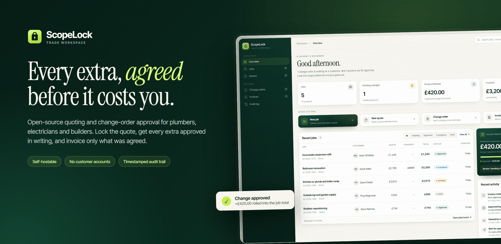
</p>

<p align="center">
  <a href="#what-it-does">What it does</a> ·
  <a href="#the-problem">The problem</a> ·
  <a href="#a-look-inside">Screenshots</a> ·
  <a href="#getting-started">Getting started</a> ·
  <a href="#how-it-is-built">How it is built</a> ·
  <a href="#status-and-roadmap">Roadmap</a>
</p>

<p align="center">
  
  
  
  
  
</p>

# ScopeLock

**ScopeLock is a small, self-hostable web app that helps a tradesperson get paid for every extra a customer asks for.**

You build a quote, send the customer a link, and once they approve it the price is locked. If they ask for more work halfway through the job, you add a change order, they approve that too on their own phone, and the final invoice includes only the work that was actually agreed.

No customer accounts. No app to install. No "I never agreed to that" at invoice time.

---

## The problem

A plumber quotes a bathroom at £2,780. The customer approves it.

Then, on site, the conversation starts:

> "While you're here, could you move the radiator?"
> "Actually, can we upgrade the shower head?"
> "The soil stack looks rusty — that's included, right?"

By the end of the job there is £900 of extra work, half of it never written down, and the customer remembers agreeing to the £2,780 quote. The tradesperson either absorbs the cost or has an awkward argument.

Big field-service suites solve this with per-seat licences, a two-week setup and a module for everything. Most sole traders and two-person firms do not need that. They need one thing: **a simple record of what was agreed, and proof the customer said yes.**

That is ScopeLock.

---

## What it does

| Step | What happens |
| --- | --- |
| **1. Create a job** | Customer, site address, job title and currency. One quick form. |
| **2. Build the quote** | Add line items with description, quantity and unit price. A live total updates as you type. |
| **3. Send for approval** | ScopeLock creates a secure link. Send it by email, SMS or WhatsApp — whichever you already use. |
| **4. Deliver the work** | When the customer approves, the quote freezes as the **baseline**. That number cannot quietly change. |
| **5. Add change orders** | Extra work goes in as a change order with its own price and its own approval link. Approved changes roll into the job total. |
| **6. Invoice what was agreed** | One live invoice per job: the approved quote plus every approved change. Export it as a PDF. |
| **7. Check the trail** | Every sent, viewed, approved and rejected decision lands in an audit timeline with a timestamp. |

The customer never creates an account. They open a link, read the quote or change, and tap approve or reject. That is the whole customer experience.

### What makes it different

- **The quote is a frozen baseline.** Once approved, it does not move. Extras are separate documents, not silent edits.
- **Only approved money is billable.** Pending changes are shown to you but never counted in the invoice.
- **The invoice is derived, not typed.** It has no stored copy of the money to drift out of sync — it is calculated from the approved quote plus approved changes every time you open it.
- **Nothing happens in private.** The audit log records who did what and when, so a disagreement is a five-second lookup instead of an argument.

---

## A look inside

### The workspace overview

Everything at a glance: active jobs, change orders waiting on customers, how much scope has been protected this month, what is still to be invoiced, and the most recent activity.

<p align="center">
  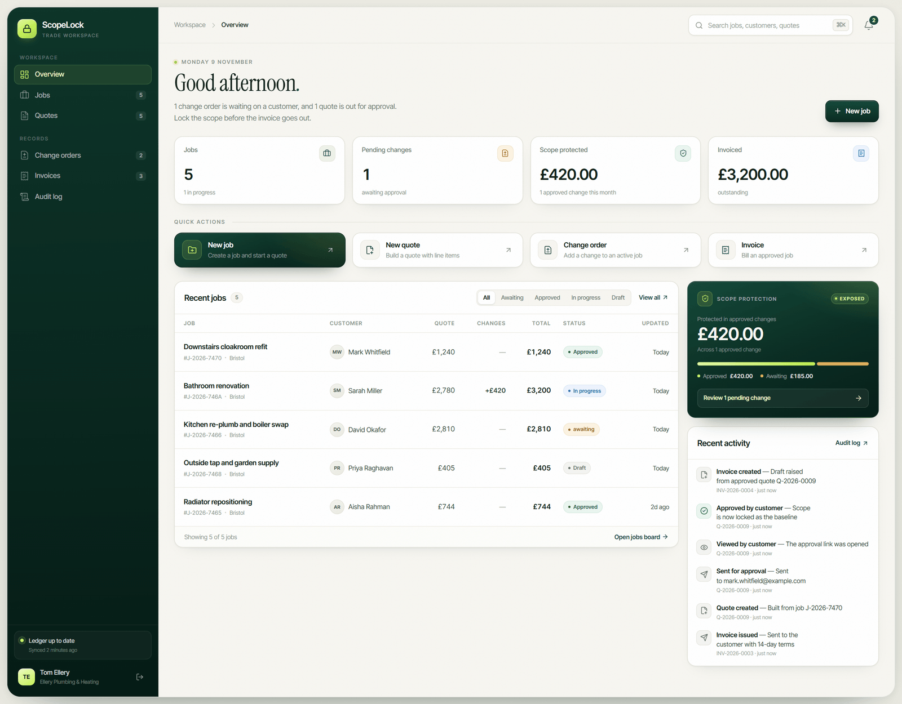
</p>

### Jobs and quotes

Every job you have scoped, quoted and delivered, plus every quote in one list with its live status.

<p align="center">
  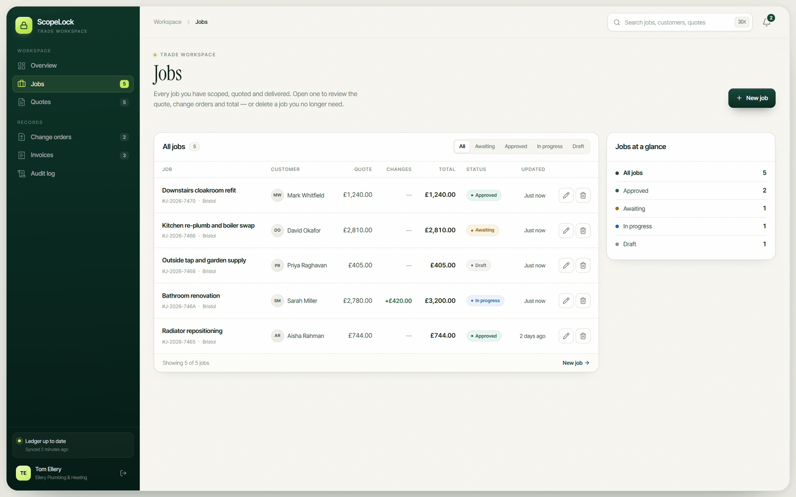
  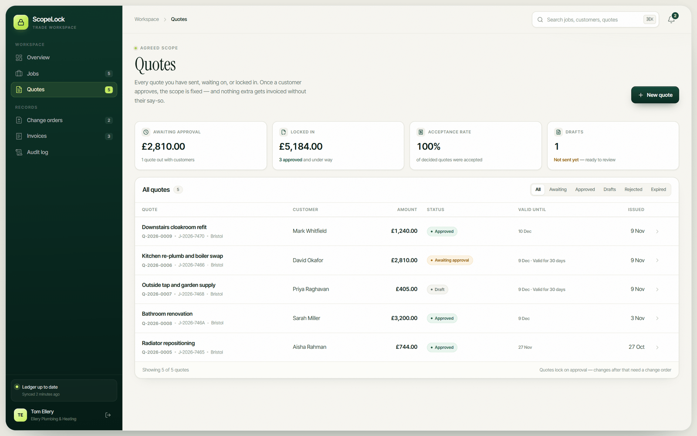
</p>

### Change orders and invoices

Change orders measure every extra against the approved quote. Invoices are statements of account: one per job, always showing the approved baseline, the approved extras and the live balance.

<p align="center">
  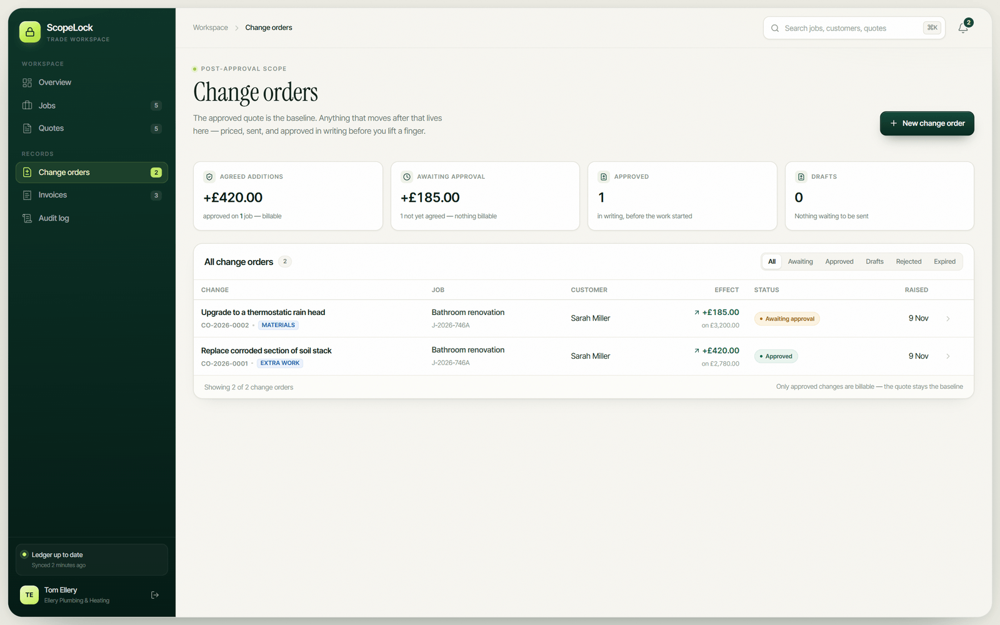
  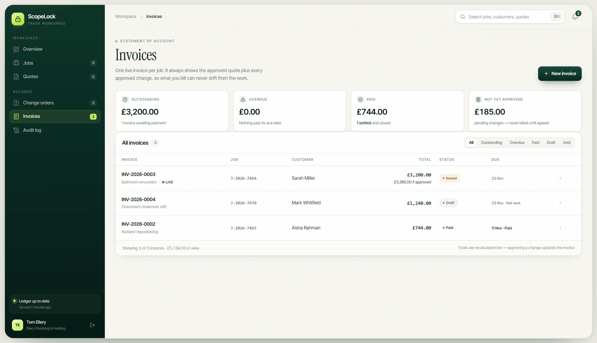
</p>

### The detail drawers

Open any quote or change order to see the line items, the approval link, the activity history and the totals — without leaving the list.

<p align="center">
  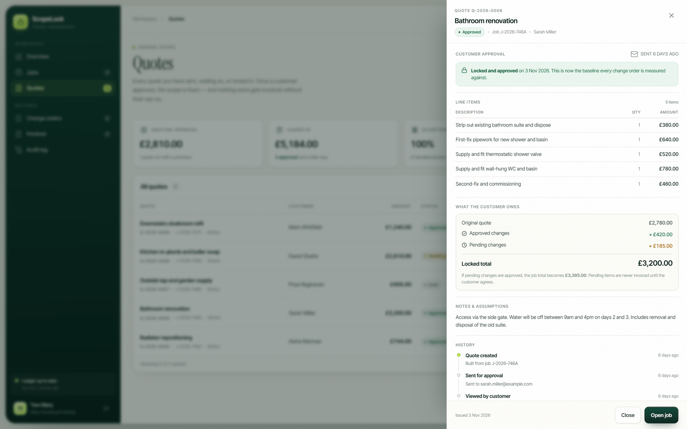
  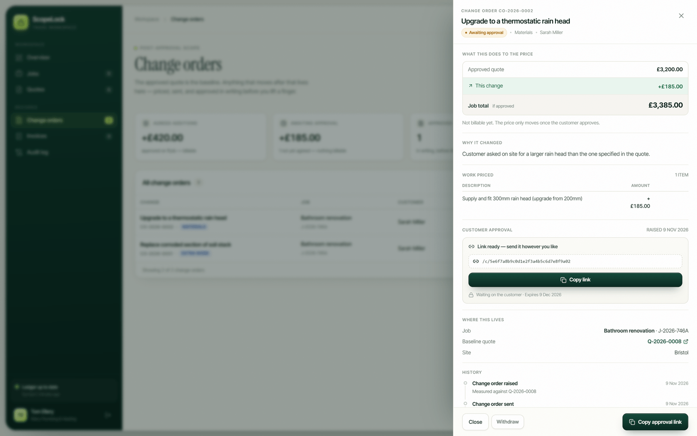
</p>

### Building a quote

A three-step builder: customer and site, line items, then review. The running total and the "what happens next" panel update as you go.

<p align="center">
  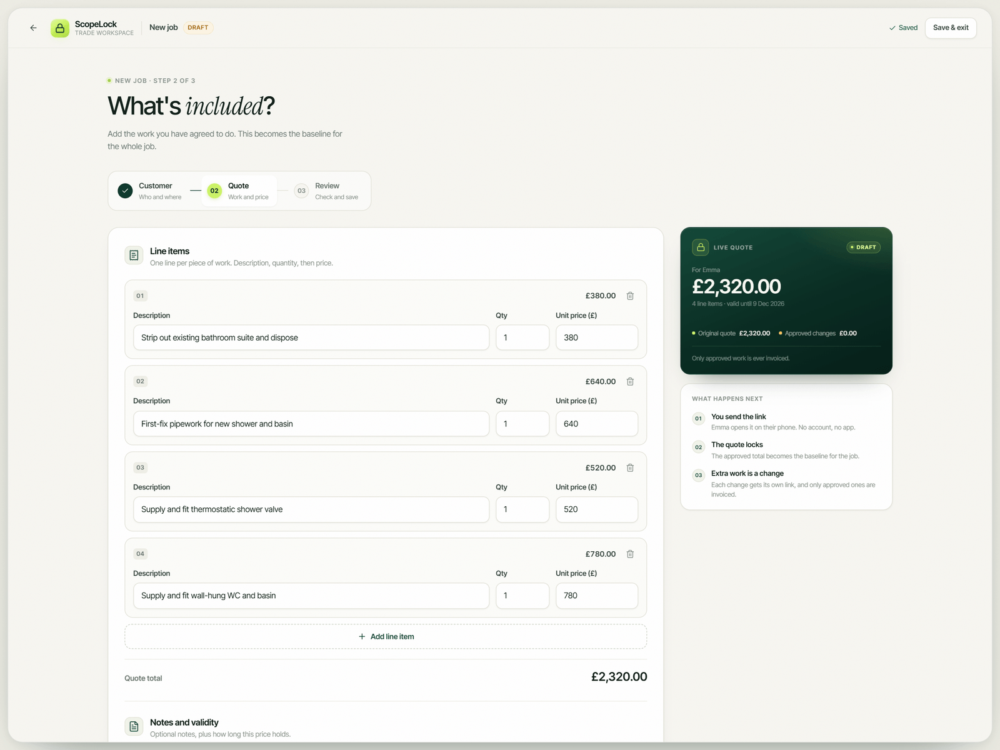
</p>

### What the customer sees

The approval pages are designed for a phone, need no account, and say exactly what is being agreed and what it changes.

<p align="center">
  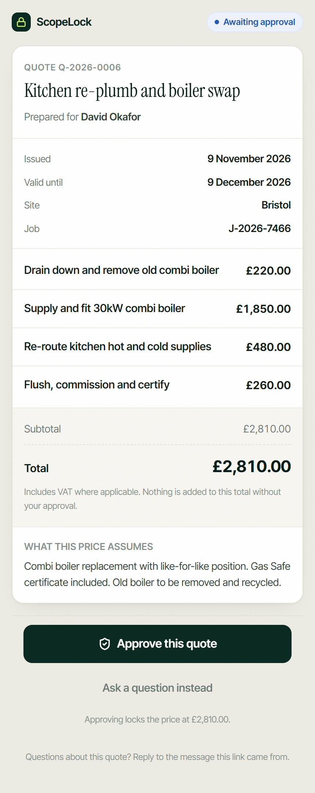
  &nbsp;&nbsp;&nbsp;
  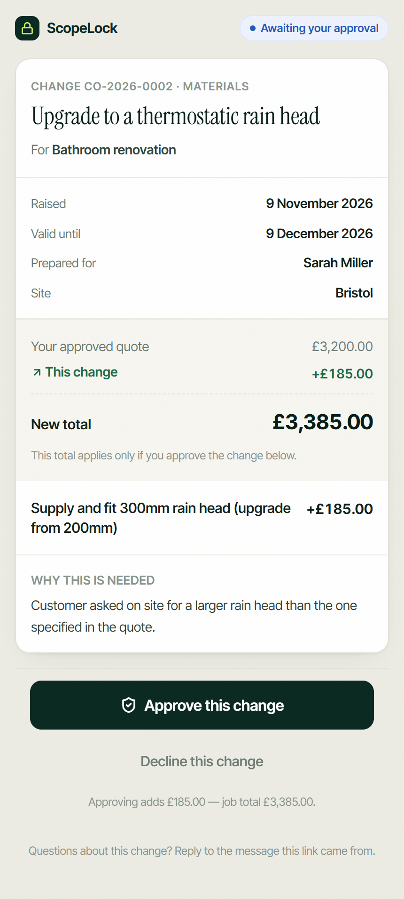
</p>

### The audit trail

Every decision, in order. Quotes, changes and invoices in a single timeline, with the ability to filter by job.

<p align="center">
  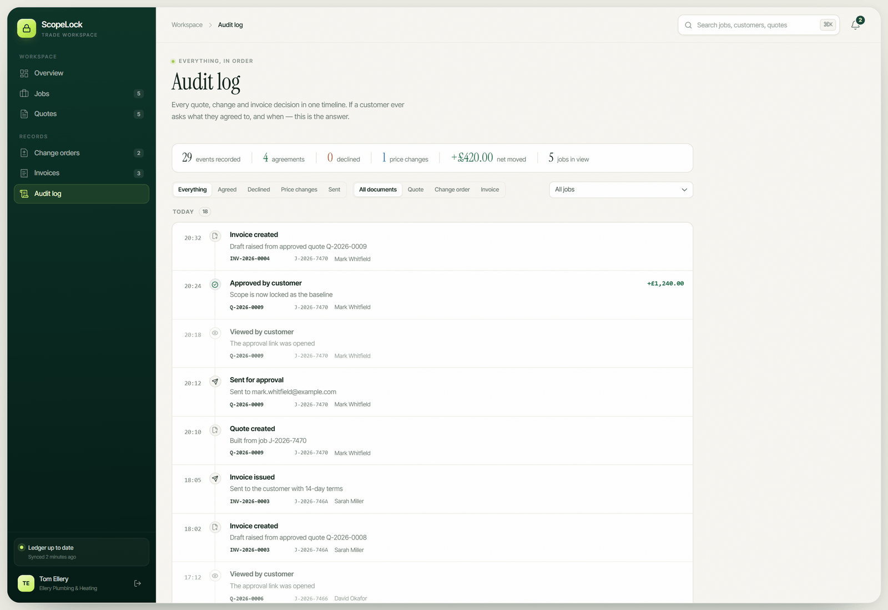
</p>

### On a phone

The workspace itself is responsive, so you can check a job or send a change order from the van.

<p align="center">
  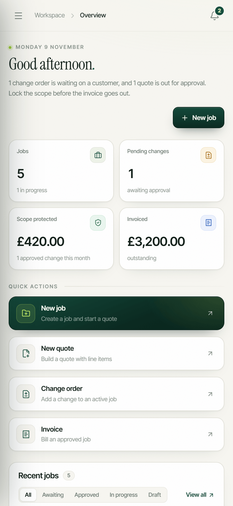
</p>

---

## Who it is for

- Plumbers, electricians, builders, joiners, plasterers and other trades
- Small firms with one to ten people who quote jobs directly with homeowners
- Anyone who has ever heard *"that was included in the quote, wasn't it?"*

It is especially useful if you work in the UK, where "variation order" and "change order" both describe the same thing, and where the paper trail matters.

## Who it is not for

- Large field-service operations that need scheduling, dispatch, stock, payroll and a CRM
- Accountants looking for double-entry bookkeeping or VAT returns
- Teams that need multi-tenant companies, role hierarchies or per-seat billing — this is a single-owner workspace today
- Anyone who wants a hosted SaaS account. ScopeLock is software you run yourself.

---

## Getting started

### What you need

- **Node.js 20.9 or newer**
- **A MongoDB database** — a free MongoDB Atlas cluster or a local `mongod` both work
- npm (bundled with Node)

### 1. Install

```bash
git clone https://github.com/<your-username>/scopelock-quote-approval.git
cd scopelock-quote-approval
npm install
```

### 2. Configure the database

Create a file called `.env.local` in the project root:

```bash
MONGODB_URI="mongodb+srv://<user>:<password>@<cluster>/<database>?retryWrites=true&w=majority"
```

A local MongoDB works just as well:

```bash
MONGODB_URI="mongodb://localhost:27017/scopelock"
```

The app stores its collections in a database named **`scopelock`**, whatever the path in your connection string says. Your credentials stay in `.env.local`, which is git-ignored.

### 3. Run it

```bash
npm run dev
```

Open **[http://localhost:8000](http://localhost:8000)**.

> The dev script is pinned to port 8000. If you prefer another port, change `dev` in `package.json`.

### 4. Create your workspace

1. Go to **[/signup](http://localhost:8000/signup)** and create an account.
2. You land on the overview with an empty workspace.
3. Choose **New job**, fill in the customer and site details, then add your line items.
4. Copy the approval link, open it in a private window, and approve your own quote to see the full flow end to end.

There is no seed script and no demo account in the repository. Everything you create is yours to delete.

### Production build

```bash
npm run build
npm start
```

`npm start` runs Next.js on its default port (3000) and expects the same `MONGODB_URI`. Put it behind a reverse proxy with HTTPS — session cookies are `HttpOnly` and `SameSite=Lax`, and public approval links are secrets.

---

## Environment variables

| Variable | Required | Description |
| --- | --- | --- |
| `MONGODB_URI` | Yes | MongoDB connection string. The app always uses the `scopelock` database on that connection. |

No other configuration is required. There is no `.env.example` yet — create `.env.local` by hand as shown above.

---

## How it is built

| Layer | Choice | Why |
| --- | --- | --- |
| Framework | **Next.js 16** (App Router, Server Actions) | One deployable unit: pages, server actions and API routes in the same codebase. |
| UI | **React 19 + TypeScript** | Typed view models between the database and the screens. |
| Styling | **Tailwind CSS v4** plus per-feature CSS | Utility classes for layout, hand-written CSS for the dense workspace UI. |
| Database | **MongoDB 7** via the official driver | Documents map naturally to quotes, line items and change orders. |
| Auth | Server-side sessions in MongoDB, scrypt hashes | Sessions can be revoked instantly; passwords never leave the server. |
| Icons | **Lucide** | Small, consistent, tree-shakeable. |

### Project layout

```
app/
  (app)/            Signed-in workspace: overview, jobs, quotes, changes, invoices, audit
  q/[token]/        Public quote approval page
  c/[token]/        Public change order approval page
  login/ signup/    Authentication screens
  auth/             Server actions and shared auth UI
lib/
  db.ts             Lazy MongoDB client
  auth.ts           Sessions, cookies, current user
  quotes.ts         Quote storage, numbering, mapping
  changes.ts        Change orders and job totals
  invoices.ts       Live invoice derivation
  dashboard.ts      Overview aggregation
  audit.ts          Audit trail construction
docs/
  banner.png        README hero image
  screenshots/      Product screenshots used above
```

### Design principles

1. **Money is stored in integer minor units.** Pence and cents, never floats. Every document carries its ISO 4217 currency.
2. **A quote stores its line items as a snapshot.** Editing a catalogue later cannot rewrite history.
3. **An invoice stores no money.** It is derived from the approved quote plus approved changes at read time, so the figures cannot disagree with the documents that own them.
4. **Only approved change orders are billable.** Pending and rejected changes are visible but excluded from the balance.
5. **The public page is deliberately narrow.** Lookup is by opaque token only; drafts are invisible even to a token holder; references are never accepted as secrets.
6. **Notifications are derived, not stored.** Deciding a quote makes its notification disappear. Nothing has to be manually cleared, so the badge cannot drift.
7. **Guards live on the server.** Every server action re-reads the documents and re-checks its rules. Buttons are a convenience, not the security boundary.

---

## Scripts

| Command | What it does |
| --- | --- |
| `npm run dev` | Start the development server on port 8000 |
| `npm run build` | Create a production build |
| `npm start` | Serve the production build |
| `npm run lint` | Run ESLint |

---

## Status and roadmap

ScopeLock is an **early preview**. The core flow — quote → approve → change → approve → invoice → audit — works end to end and is what the screenshots above show.

**Working today**

- Email/password accounts with server-side sessions
- Jobs, quotes with line items, and per-job currency (GBP/EUR)
- Secure public approval links for quotes and change orders
- Approve/reject decisions recorded with timestamps
- Live invoice derivation, payment status, and print-ready PDF export
- Dashboard, notifications, search and audit timeline
- Responsive layout down to phone width

**Next, in rough order**

- Real email/SMS delivery instead of copy-and-send links
- Optional QR code on the change order screen for on-site approval
- Company branding and logo on quotes and invoices
- Recurring line items and a reusable price list
- Multi-user workspaces with roles
- Exportable CSV reports

**Deliberately out of scope for now**

- Scheduling, dispatch and route planning
- Stock control and purchase orders
- Full accounting, VAT returns and bank reconciliation
- A hosted multi-tenant service

If you want to suggest something, open an issue with the job you are trying to get done, not just the feature name.

---

## Contributing

Issues and pull requests are welcome. A few ground rules:

- Keep the flow plain. If a change makes the customer approval page more complicated, it probably belongs somewhere else.
- Money handling must stay in integer minor units. No floats, no formatting in the database.
- Server actions must re-check their own guards; do not trust the client.
- Add a screenshot or a short description of the before/after for UI changes.

Before opening a pull request:

```bash
npm run lint
npm run build
```

---

## Licence

No licence file is included yet. If you plan to make this repository public and want others to reuse the code, add a licence (MIT is a common choice) before publishing. Until then, the default copyright rules apply.
