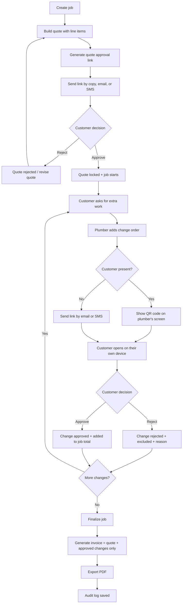

# ScopeLock — Feature Flow

This is the exact flow of the application, from a new job to a final invoice. It is a feature flow, not a timeline.

---

## The flow at a glance

---

## Step-by-step flow

### Step 1 — Create the job

**Feature:** Job setup.

The plumber creates a job with the customer name, contact details, address, job title, and date. They choose GBP or EUR.

**Output:** An empty job workspace.

---

### Step 2 — Build the quote

**Feature:** Quote builder.

- Add line items: description, quantity, unit price, line total.
- Add notes and the validity date.
- See the quote total update automatically.
- Save as a draft.

**Output:** A draft quote.

---

### Step 3 — Send the quote for approval

**Feature:** Quote approval link.

- Generate a secure, expiring link.
- Send it by copy, email, or SMS.
- The customer opens it in a browser without an account.
- The customer sees the full quote and approves or rejects it.

**Output:** Quote status becomes approved, rejected, or expired.

---

### Step 4 — Lock the quote and start the job

**Feature:** Status engine.

- On approval, the quote is locked.
- The job status changes to "in progress".
- The approved quote becomes the baseline for all future changes.

**Output:** A locked original scope.

---

### Step 5 — Add a change order

**Feature:** Change order creation.

The customer asks for extra work. The plumber opens the job and taps "Add change".

Fields:

- description,
- amount,
- optional photo,
- optional note,
- who requested it.

The change starts as **pending approval**.

**Output:** A pending change order.

---

### Step 6 — Choose the approval mode

**Feature:** In-person or remote approval.

If the customer is present:

- show a QR code on the plumber's screen,
- the customer scans it and approves on their own phone.

If the customer is not present:

- send the link by email or SMS.

The customer always performs the approval themselves.

**Output:** The customer sees the change on their own device.

---

### Step 7 — Customer approves or rejects

**Feature:** Change decision.

The customer sees:

- the change description,
- the amount,
- the photo,
- the updated job total.

They approve or reject.

**Output:**

- Approved: the change is added to the job total.
- Rejected: the change is excluded, with an optional reason.
- No response: the change stays pending and is excluded from the invoice.

---

### Step 8 — Totals update

**Feature:** Totals and status engine.

The job always shows:

- original quote total,
- approved changes total,
- pending changes total,
- rejected changes total,
- current job total,
- final invoice total.

**Output:** A clear picture of what is agreed and what is not.

---

### Step 9 — Repeat for each change

**Feature:** Change history.

Every change is listed on the job with its status, amount, approval date, and approval method. The plumber can add as many changes as the job needs.

**Output:** A complete change history.

---

### Step 10 — Finalize the job

**Feature:** Final invoice.

- The plumber marks the job as complete.
- The app generates a PDF invoice with:
  - business details,
  - customer details,
  - original quote line items,
  - approved changes as separate line items with approval dates,
  - total,
  - payment terms and notes.
- Pending and rejected changes are never included.

**Output:** A final invoice PDF.

---

### Step 11 — Export and audit

**Feature:** Audit log.

- Export the invoice PDF.
- Export the audit log as PDF or CSV.
- The audit log records the quote, every change, every approval, the method, the timestamp, and the document version.

**Output:** A defensible record of what was agreed.

---

## Status model

| Object | Statuses |
|---|---|
| Quote | draft, sent, approved, rejected, expired |
| Job | draft, awaiting approval, in progress, completed |
| Change order | pending, approved, rejected, cancelled |
| Invoice | draft, final |

---

## Feature map

| Flow step | Feature | Required in v1? |
|---|---|---|
| 1 | Job creation | Yes |
| 2 | Quote builder with line items | Yes |
| 3 | Quote approval link | Yes |
| 4 | Quote lock and job status | Yes |
| 5 | Change order creation | Yes |
| 6 | QR / link approval | Yes |
| 7 | Approve or reject decision | Yes |
| 8 | Totals and status engine | Yes |
| 9 | Change history | Yes |
| 10 | Final invoice PDF | Yes |
| 11 | Audit log export | Yes |
| — | Responsive mobile-first UI | Yes |
| — | Self-host packaging | Yes |
| — | AI quote drafting | No — paid add-on |
| — | Photo-to-line-item | No — paid add-on |
| — | SMS/WhatsApp provider | No — paid add-on |
| — | Templates and branding | No — paid add-on |
| — | Multi-user roles | No — paid add-on |
| — | CRM, scheduling, payments, accounting | No — excluded |

---

## The core loop

**Quote → approve → change → approve → invoice → audit.**

Every feature supports one of those six steps. If it does not, it is not in v1.
